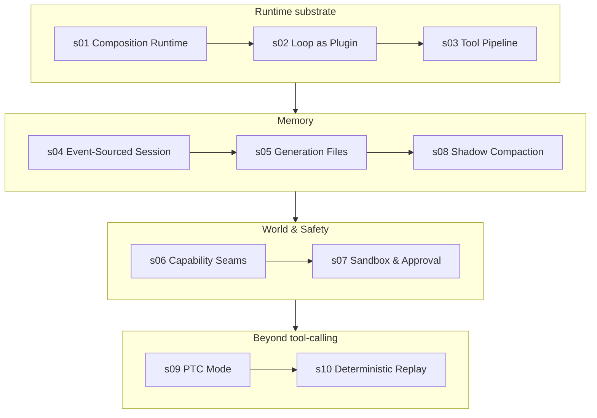

English | [中文](README.zh.md)

# Learn DeepSeek Harness — Everything Is a Plugin

> Companion course to [deepseek-harness](https://github.com/deepseek-ai/deepseek-harness) (`dsh`, by DeepSeek AI).
> A 10-chapter, code-first tour of an agent runtime with **no privileged core** — where the agent loop itself is a plugin you can replace from config.

## The Thesis: No Privileged Core

Most agent frameworks have a kernel with special rights: the loop is hard-coded, tools are built in, persistence is welded to the product. Extensions hook *around* the edges.

dsh inverts this completely, built on the [Cordis](https://github.com/cordiverse/cordis) composition framework:

> "There is no patchable privileged core. Model adapters, tool registries, session logging — even the default agent loop — are plugins, all replaceable from configuration."

```
dsh = a composition runtime (Cordis: ctx.effect / ctx.on / services)
    + plugin everything:  agent-loop, tools, session, sandbox, llm adapters...
    + event-sourced sessions (append-only logs; the request is rebuilt from them)
    + capability seams (fs/shell/ssh behind interfaces; swap local -> remote)
    + native sandboxing (Landlock / Seatbelt / restricted tokens) + fail-closed approval
    + shadow compaction (projection shrinks; the log never rewrites)
    + PTC mode (the model writes code that calls a generated tool SDK)
    + deterministic replay (recorded sessions are the test suite)
```

The question this course answers: **what does it take to build a runtime where "replace the agent loop" is a config line?**

## What You Will Build

A **mini-dsh**: ~1600 lines across 10 chapters, each standalone and runnable offline with a scripted LLM (dsh itself ships an LLM mock server for exactly this — free, deterministic agent development).

| Chapter | Topic | Motto | Key Concepts |
|---|---|---|---|
| [s01](s01_composition_runtime/) | Composition Runtime | *Registration is a side effect* | mini-cordis / `ctx.effect` / `ctx.on` / disposers / reversibility |
| [s02](s02_loop_as_plugin/) | Loop as Plugin | *Even the loop is a plugin* | `AgentFactory` registry / turn & step / inbox claiming |
| [s03](s03_tool_pipeline/) | Tool Pipeline | *One pipeline, five gates* | `defineTool` DSL / pre-execute → guard → execute → post-execute → result |
| [s04](s04_event_sourced_session/) | Event-Sourced Session | *Model-visible means logged* | append-only `SessionEvent` / `deriveMessages` projection / rebuild invariant |
| [s05](s05_generation_files/) | Generation Files | *Committed generations never change* | versioned JSONL / exclusive write lock / crash repair / checkpoint policy |
| [s06](s06_capability_seams/) | Capability Seams | *Define the seam, swap the world* | definition / provider / consumer / local vs remote worlds |
| [s07](s07_sandbox_approval/) | Sandbox & Approval | *Fail closed, escalate once* | three modes / monotonic policy / answerer waterfall / one-shot elevation |
| [s08](s08_shadow_compaction/) | Shadow Compaction | *Shadow the past, never erase it* | tool-result pruner / summary events / shadowed projections |
| [s09](s09_ptc_mode/) | PTC Mode | *Code is the tool-calling protocol* | `run_code` transport / generated SDK / parallelism in code |
| [s10](s10_deterministic_replay/) | Deterministic Replay | *Record once, replay forever* | scrubbing / snapshot = replay input = expected output |

## Learning Path



## How to Run

Every chapter is a **single dependency-free TypeScript file** in erasable-only syntax, run directly on Node (same discipline as dsh's own tree):

```sh
# Node >= 22.18
node s01_composition_runtime/code.ts

# Older Node 22.x
node --experimental-strip-types s01_composition_runtime/code.ts
```

All chapters run **offline and deterministically** — the LLM is scripted, the sandboxes are simulated, and the file system work happens in temp directories.

## Project Structure

```
learn-deepseek-harness/
  s01_composition_runtime/
    README.md          # English chapter README
    README.zh.md       # Chinese translation
    code.ts            # standalone runnable implementation (zero deps)
  ...
  s10_deterministic_replay/
  README.md            # this file
```

## Map to the Real dsh Source

| Course concept | Real location (under `deepseek-harness/`) |
|---|---|
| Cordis runtime (vendored) | `vendor/` (`@deepseek-ai/cordis`) + `docs/cordis-tutorial/` |
| Plugin-as-loop | `packages/core/agent-loop/` (`ReactLoopAgent`, registers on `ctx.agents`) |
| Tool runtime + pipeline | `packages/core/tools/` + `docs/tool-execution-pipeline.md` |
| Session events + projections | `packages/core/session/` + `packages/session/session-projection/` |
| JSONL persistence, generation files | `packages/session/session-persistence-jsonl/` |
| Exclusive write (flock) | `native/system/` (`@deepseek-ai/node-addon-system`) |
| Capability seams (fs/shell/ssh) | `packages/fs/`, `packages/shell/`, `packages/subprocess/`, `packages/ssh/` + `docs/capability-seams.md` |
| Sandbox + approval | `packages/sandbox/` + `packages/interaction/user-approval/` + `docs/subsystems/sandbox.md` |
| Compaction family | `packages/compaction/` (5 packages) |
| PTC (run_code + SDK) | `packages/core/tools/src/ptc.ts` + `packages/ptc-runtime/` |
| Replay snapshots | `snapshots/` (100+ recorded scenarios) + `snapshots/AGENTS.md` |
| LLM mock for tests | `packages/test-support/` |
| Python SDK (subprocess JSON-RPC) | `python/sdk/` |

## How This Course Relates to learn-claude-code and learn-pi

Three courses, three philosophies, one loop:

- **learn-claude-code**: mechanisms *built into* a harness — permissions, sub-agents, teams as first-class systems (Python, Anthropic API).
- **learn-pi**: mechanisms *pushed out* to extensions over a thin event-driven kernel (TypeScript, TypeBox, faux provider).
- **learn-deepseek-harness** (this course): mechanisms *composed from plugins* over a composition runtime — no privileged core at all, memory is event-sourced, and every session doubles as a deterministic test (TypeScript, Cordis concepts).

Read together, they map the entire design space of agent harness engineering.

## License

MIT
