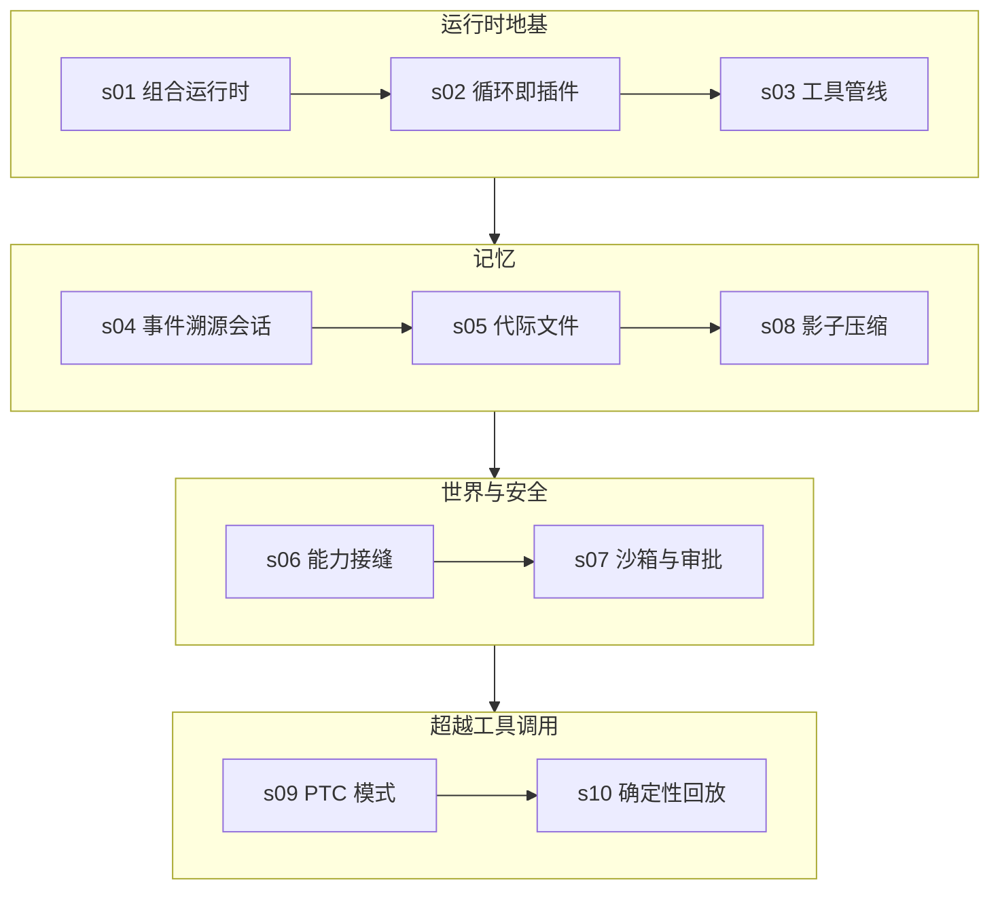

[English](README.md) | 中文

# Learn DeepSeek Harness — 一切皆插件

> 本课程是 [deepseek-harness](https://github.com/deepseek-ai/deepseek-harness)（`dsh`，DeepSeek AI 出品）的配套学习仓库。
> 共 10 章，以代码为核心，带你走读一个**没有特权核心**的 agent 运行时——连 agent 循环本身都是一个可从配置中替换的插件。

## 核心命题：没有特权核心

大多数 agent 框架都有一个拥有特殊权利的内核：循环写死、工具内置、持久化焊死在产品里。扩展只能在边缘"绕着挂"。

dsh 建立在 [Cordis](https://github.com/cordiverse/cordis) 组合框架之上，彻底颠倒了这一切：

> "没有可被 patch 的特权核心。模型适配器、工具注册表、会话日志——连默认的 agent 循环——都是插件，全部可以从配置替换。"

```
dsh = 一个组合运行时（Cordis：ctx.effect / ctx.on / 服务）
    + 一切皆插件：agent-loop、tools、session、sandbox、llm 适配器……
    + 事件溯源会话（追加式日志；请求从日志重建）
    + 能力接缝（fs/shell/ssh 藏在接口后；本地一键换远程）
    + 原生沙箱（Landlock / Seatbelt / 受限令牌）+ 默认拒绝的审批
    + 影子压缩（投影缩小；日志绝不改写）
    + PTC 模式（模型写代码调用生成的工具 SDK）
    + 确定性回放（录制的会话就是测试套件）
```

本课程回答的问题是：**要造一个"换掉 agent 循环"只需一行配置的运行时，到底需要什么？**

## 你将构建什么

一个 **mini-dsh**：10 章共约 1600 行代码，每章独立可运行，默认用脚本化 LLM 离线运行（dsh 自己就内置了 LLM mock 服务器，目的完全相同——免费、确定的 agent 开发）。

| 章节 | 主题 | 格言 | 关键概念 |
|---|---|---|---|
| [s01](s01_composition_runtime/) | 组合运行时 | *注册即副作用* | mini-cordis / `ctx.effect` / `ctx.on` / disposer / 可逆性 |
| [s02](s02_loop_as_plugin/) | 循环即插件 | *连循环都是插件* | `AgentFactory` 注册表 / turn 与 step / inbox 认领 |
| [s03](s03_tool_pipeline/) | 工具管线 | *一条管线，五道闸门* | `defineTool` DSL / pre-execute → guard → execute → post-execute → result |
| [s04](s04_event_sourced_session/) | 事件溯源会话 | *模型可见即已落日志* | 追加式 `SessionEvent` / `deriveMessages` 投影 / 重建不变量 |
| [s05](s05_generation_files/) | 代际文件 | *已提交的代永不改写* | 版本化 JSONL / 独占写锁 / 崩溃修复 / 检查点策略 |
| [s06](s06_capability_seams/) | 能力接缝 | *定义接缝，替换世界* | 定义 / 提供者 / 消费者 / 本地与远程两个世界 |
| [s07](s07_sandbox_approval/) | 沙箱与审批 | *默认拒绝，一次性提权* | 三级模式 / 单调策略 / answerer 瀑布 / 一次性提权 |
| [s08](s08_shadow_compaction/) | 影子压缩 | *影子替换，绝不抹除* | 工具结果修剪器 / 摘要事件 / 被影子的投影 |
| [s09](s09_ptc_mode/) | PTC 模式 | *代码本身就是工具调用协议* | `run_code` 传输工具 / 生成的 SDK / 代码内并行 |
| [s10](s10_deterministic_replay/) | 确定性回放 | *录一次，永远回放* | 脱敏 / 快照 = 回放输入 = 期望输出 |

## 学习路径



## 如何运行

每一章都是**一个零依赖的 TypeScript 单文件**，只用可擦除语法，直接跑在 Node 上（与 dsh 自己代码树的纪律一致）：

```sh
# Node >= 22.18
node s01_composition_runtime/code.ts

# 较老的 Node 22.x
node --experimental-strip-types s01_composition_runtime/code.ts
```

所有章节**离线、确定性运行**——LLM 是脚本、沙箱是模拟、文件系统操作都发生在临时目录里。

## 项目结构

```
learn-deepseek-harness/
  s01_composition_runtime/
    README.md          # 英文章节文档
    README.zh.md       # 中文翻译
    code.ts            # 独立可运行实现（零依赖）
  ...
  s10_deterministic_replay/
  README.md            # 本文件
```

## 对照真实 dsh 源码

| 课程概念 | 真实位置（`deepseek-harness/` 下） |
|---|---|
| Cordis 运行时（vendored） | `vendor/`（`@deepseek-ai/cordis`）+ `docs/cordis-tutorial/` |
| 循环即插件 | `packages/core/agent-loop/`（`ReactLoopAgent`，注册到 `ctx.agents`） |
| 工具运行时与管线 | `packages/core/tools/` + `docs/tool-execution-pipeline.md` |
| 会话事件与投影 | `packages/core/session/` + `packages/session/session-projection/` |
| JSONL 持久化、代际文件 | `packages/session/session-persistence-jsonl/` |
| 独占写（flock） | `native/system/`（`@deepseek-ai/node-addon-system`） |
| 能力接缝（fs/shell/ssh） | `packages/fs/`、`packages/shell/`、`packages/subprocess/`、`packages/ssh/` + `docs/capability-seams.md` |
| 沙箱与审批 | `packages/sandbox/` + `packages/interaction/user-approval/` + `docs/subsystems/sandbox.md` |
| 压缩家族 | `packages/compaction/`（5 个包） |
| PTC（run_code + SDK） | `packages/core/tools/src/ptc.ts` + `packages/ptc-runtime/` |
| 回放快照 | `snapshots/`（100+ 录制场景）+ `snapshots/AGENTS.md` |
| 测试用 LLM mock | `packages/test-support/` |
| Python SDK（子进程 JSON-RPC） | `python/sdk/` |

## 与 learn-pi 的关系


- **learn-pi**：机制*推出*到扩展——薄薄的事件驱动内核（TypeScript、TypeBox、faux provider）。
- **learn-deepseek-harness**（本课程）：机制*组合自插件*——组合运行时之上没有特权核心，记忆是事件溯源的，每个会话同时是一份确定性测试（TypeScript、Cordis 概念）。

## 许可

MIT
